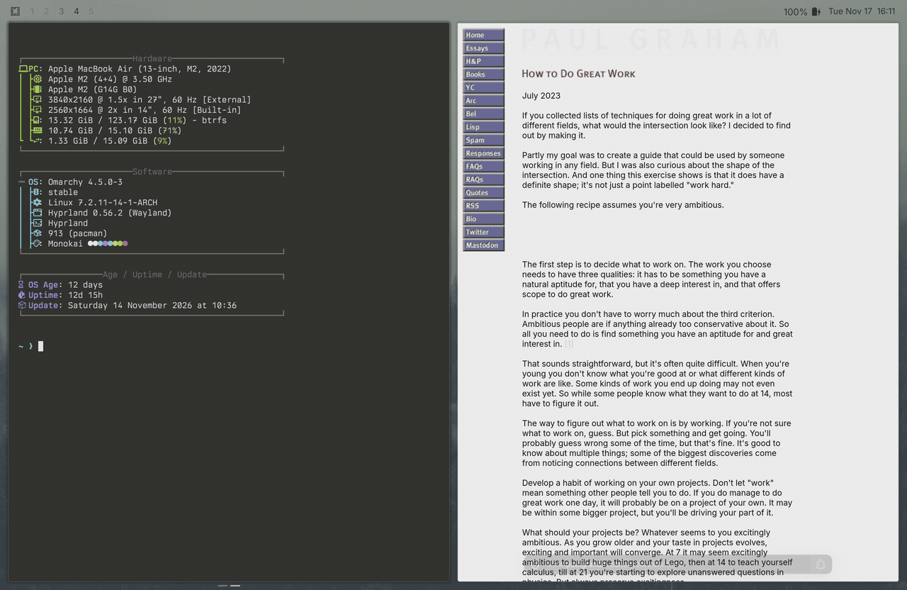
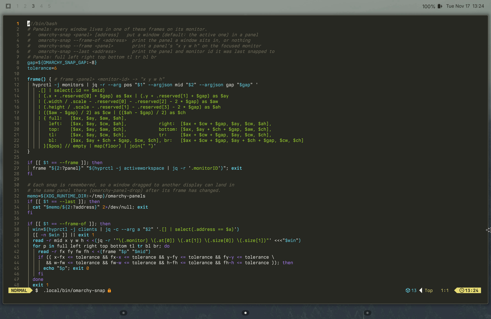

# Omarchy, calm and Mac-like

My [Omarchy](https://omarchy.org) setup on a MacBook Air (M2) running Asahi Linux. It's Hyprland in floating mode, set up to feel like macOS: windows live in panes, there's little chrome, and colours stay calm.


## What's different from stock Omarchy

**Panes instead of tiling.** Every window sits in one of nine panes per display: full screen, left or right half, top or bottom half, or a quarter. Windows in the same pane form a *stack*. New windows open on top of the pane you're in and fade in already at full size.



**Stack dots.** A band along the bottom of each display shows a dot for every window in a stack. When a full-screen window covers other panes, their dots stay (dimmed) and the full-screen window gets one in the middle. Click any dot to bring that window to the front.



**Spotlight (Cmd+Space or Cmd+K).** Omarchy's menu, widened. It has a search field across the top and a status column on the right (Wi-Fi, Bluetooth, power, sound, weather, updates) that replaces the tray icons. Arrow right to reach the status column.


**Quiet top bar.** Workspaces on the left, battery % and date on the right, nothing else. The top bar and the bottom dot band can be black (they blend into the notch, like part of the hardware) or clear over the wallpaper: Spotlight → Trigger → Toggle → Clear/Black Bars, or `omarchy-bands clear|black`.

**Multiple displays.** Each display has its own five workspaces, and trackpad swipes work on each. Moving a window to another display keeps its pane: a full-screen window stays full screen, and a left half lands in the left half.

**Look.** Hand-made Monokai theme with a warm grey accent, the Inter UI font, 3pt window corners and hairline borders. No dock and no screensaver.

**Firefox.** Square, compact toolbar with no tab strip; tabs still work with Ctrl+T, Ctrl+Tab and Ctrl+1–9. The address bar has no box at rest and no search-engine pill. DuckDuckGo is the default search, uBlock Origin Lite blocks ads using only built-in rules, new tabs are blank, and trackpad scrolling has a Mac-like glide.

## Keys

The Mac's Cmd key is Super here.

| Keys | Does |
|---|---|
| Cmd+Space / Cmd+K | Spotlight |
| Cmd+Tab / Cmd+Shift+Tab | next / previous pane (all displays) |
| Option+Tab / Option+Shift+Tab | next / previous window in this pane's stack |
| Cmd+` | next window in this pane's stack |
| Cmd+arrows | focus the pane in that direction (past the edge: next workspace) |
| Ctrl+Option+Left/Right | snap to the left/right half; again to move to the next display |
| Ctrl+Option+Up/Down | move to the display above/below, same pane |
| Ctrl+Option+Return | full screen |
| Ctrl+Option+U/I/J/K | quarters |
| Cmd+N / Cmd+Shift+N | new window of this app, in this pane / full screen |
| Cmd+T | new tab |
| Cmd+drag | move a window; letting go drops it into a pane |
| 3 or 4 fingers left/right | switch workspace |
| 4-finger spread / pinch | show desktop / bring windows back |

## Install

On a fresh Omarchy install:

```sh
git clone --bare https://github.com/bradgessler/omarchy.git ~/.dotfiles
dotfiles() { git --git-dir="$HOME/.dotfiles" --work-tree="$HOME" "$@"; }

# Omarchy's own copies of these files are in the way: move them to
# ~/.dotfiles-backup, then check out.
dotfiles ls-tree -r --name-only HEAD | while read -r f; do
  [ -e "$HOME/$f" ] && mkdir -p "$HOME/.dotfiles-backup/$(dirname "$f")" && mv "$HOME/$f" "$HOME/.dotfiles-backup/$f"
done
dotfiles checkout

~/.local/bin/omarchy-dotfiles-setup
```

The files are tracked in place: `~/.dotfiles` is a bare git repo whose working tree is your home folder, and only files added explicitly are tracked. After the first checkout, `~/.local/bin/dotfiles` works exactly like `git`:

```sh
dotfiles status
dotfiles add ~/.config/hypr/bindings.lua
dotfiles commit -m "Tweak bindings"
```

`omarchy-dotfiles-setup` handles what files can't. It installs the Inter font package and sets the GNOME font and cursor size. It copies the Firefox settings into your own profile and installs the Firefox policy (DuckDuckGo plus uBlock Origin Lite) in `/etc/firefox/policies`. Then it sets the Monokai theme and wallpaper and reloads Hyprland and the shell. It asks for your password for the system parts, and it's safe to run again.

## Machine-specific bits

- `~/.config/hypr/monitors.lua` is set up for an LG UltraFine 5K above the laptop. That display's native 5K is split into two halves (tiles), and Asahi can drive only one, so it runs at 3840x2160 scaled 1.5. Other displays fall back to Omarchy's automatic settings.
- The terminal font, Berkeley Mono, is licensed and not included; without it you get the system monospace font.
- The Firefox files live under my profile's folder name; the setup script copies them into yours.

## Where things are

| Path | What |
|---|---|
| `.config/hypr/` | key bindings, panes, gestures, animations, displays |
| `.local/bin/omarchy-*` | the pane scripts (`omarchy-snap`, `omarchy-pane-cycle`, `omarchy-stack-cycle`, `omarchy-snap-dir`, ...) and `omarchy-bands` |
| `.config/omarchy/plugins/` | shell plugins: Spotlight (`bradgessler.menu`), stack dots, bottom band, tray, workspaces |
| `.config/omarchy/themes/monokai/` | the theme |
| `.config/omarchy/shell.json` | bar layout and shell settings |
| `.config/mozilla/firefox/*/` | `user.js` and `userChrome.css` |
| `.claude/skills/brad-desktop/` | notes for Claude Code on how all this fits together |
