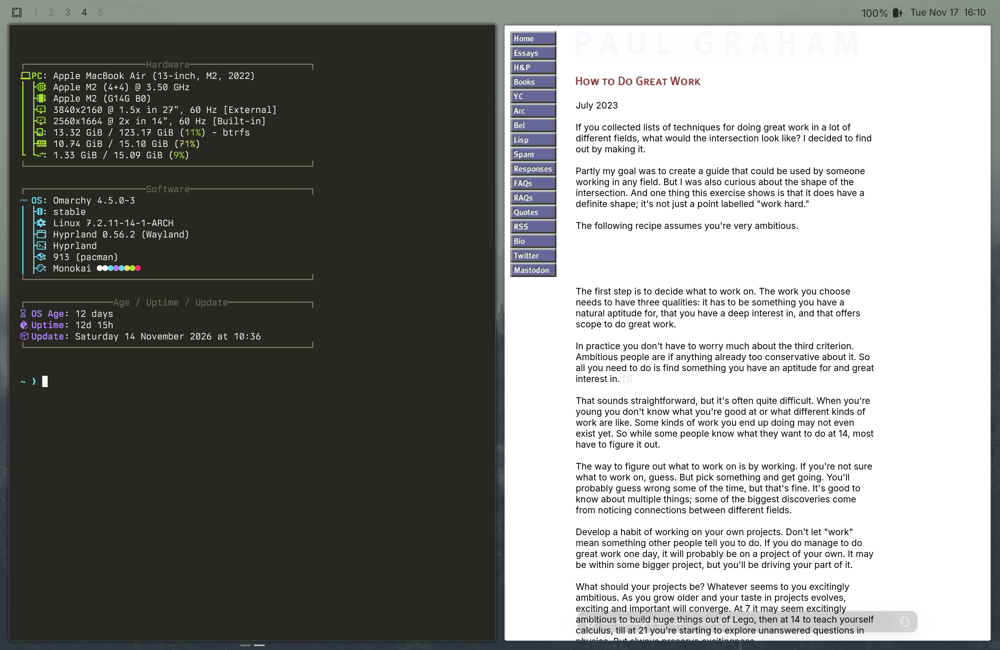
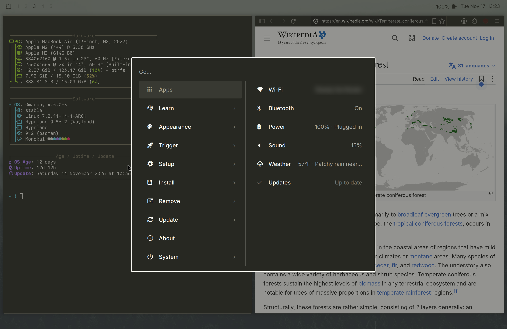
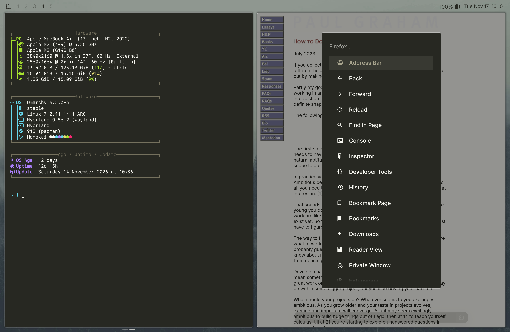
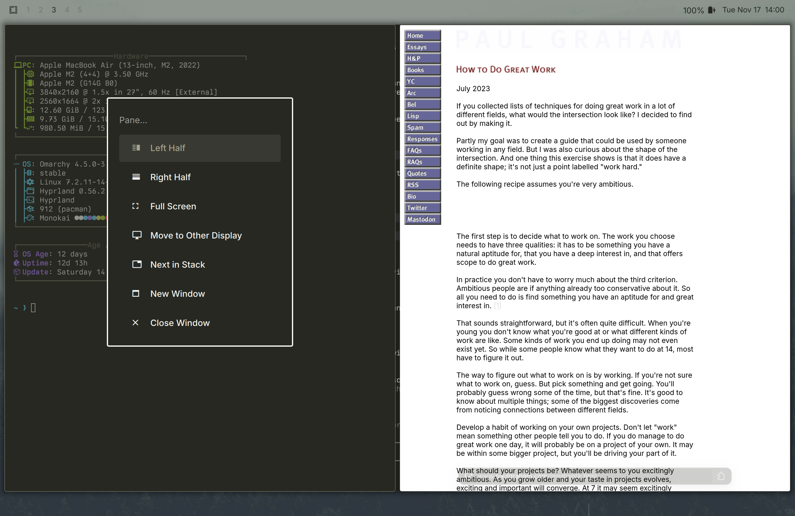
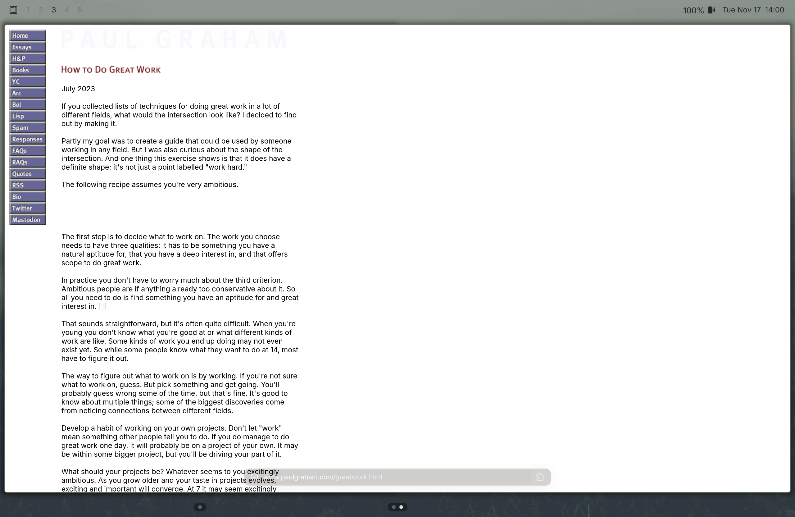
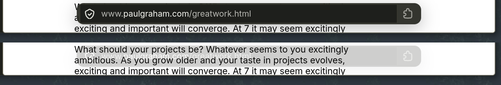

# Calmarchy

The [Omarchy](https://omarchy.org) UI is the embodiment of a bag of Doritos and a can of Surge: neon borders, tiles flying everywhere, a keybinding for every mood, and a screensaver that sets your text on fire.

I wanted something calm. Calmarchy is for people coming over from macOS who like what's underneath but want to put the Surge down: calm colours, no tabs, windows that stay where you put them, and two menus to get around, **Cmd+Space** for the system and **Cmd+K** for whatever app you're in.

It isn't a fork, just an idea: a set of config files, scripts and shell plugins that sit on top of a stock Omarchy install, which keeps updating as usual. This is my setup on a MacBook Air (M2) running Asahi Linux, with Hyprland in floating mode, set up to feel like macOS: windows live in panes, there's little chrome, and colours stay calm.



## What's different from stock Omarchy

**Panes and stacks, no tabs.** I can't stand tabs, so there are none: no tab bars, no Hyprland groups, no tabs in Firefox at all. Instead every window sits in one of nine panes per display: full screen, left or right half, top or bottom half, or a quarter. Windows in the same pane form a *stack*, which plays the role tabs would. New windows fill the empty half next to you when there is one, and otherwise open on top of the pane you're in. Either way they fade in already at full size. Cmd+Tab moves between panes and Option+Tab between the windows stacked in one.


**Stack dots.** A band along the bottom of each display shows a dot for every window in a stack. When a full-screen window covers other panes, their dots stay (dimmed) and the full-screen window gets one in the middle. They sit faint; when you switch, the dot for the window that just came forward fades up, then settles. Hovering the band lifts them so you can pick one. Click any dot to bring that window to the front.


**Spotlight (Cmd+Space): the system.** Omarchy's menu, widened. It has a search field across the top and a status column on the right (Wi-Fi, Bluetooth, power, sound, weather, updates) that replaces the tray icons; arrow right to reach it. Type a web address and the first row opens it; type anything else and you can search the web.



**Cmd+K: the app in front.** Panes are just content; their chrome lives here. Cmd+K dims only the pane you're in and opens a small menu over it, with fuzzy search over that app's actions plus the pane moves (halves, full screen, other display, next in stack, new window, close). In Firefox that's the address bar, back, forward, reload, find, console, inspector, history, bookmarks, downloads and the rest; in Signal it's new message, search, next chat, attach, settings and so on, with Signal's own File/Edit/View bar hidden. Adding an app is a few lines in `~/.config/omarchy/extensions/omarchy-menu.jsonc`.



Apps without their own menu get just the pane moves:



**A calm browser.** Firefox has no toolbars at all: no tab strip, no buttons, no bar across the top. The page fills the pane.



The address floats in a small pill at the bottom center. Each time a page loads it shows at full strength for three seconds, then fades to a faint pill that stays put, so you always know where the real address is. Hover brings it back. On any page that isn't secure it stays fully up with a warm border. Every page gets a little room at the end, so scrolling to the bottom always clears it.



DuckDuckGo is the default search, uBlock Origin Lite blocks ads using only built-in rules (no downloaded lists), new tabs are blank, typing an address fills in inline instead of popping up suggestions, link previews are off, and trackpad scrolling has a Mac-like glide. Tabs are off: Cmd+T opens a new window right on the stack you're in, and links that would open a tab (or middle-clicks) open a window too.

**Quiet top bar.** Workspaces on the left, battery % and date on the right, nothing else. The top bar and the bottom dot band can be black (they blend into the notch, like part of the hardware) or clear over the wallpaper: Spotlight → Trigger → Toggle → Clear/Black Bars, or `omarchy-bands clear|black`.

**Multiple displays.** Each display has its own five workspaces, and trackpad swipes work on each. Moving a window to another display keeps its pane: a full-screen window stays full screen, and a left half lands in the left half.

**Look.** Hand-made Monokai theme with a warm grey accent, the Inter UI font, 3pt window corners, neutral hairline borders. Windows have no borders; the active one is marked by a soft shadow. Nothing dims, so colours inside windows are never altered. Spotlight and Cmd+K cards get a faint hairline. No dock and no screensaver.

## Keys

The Mac's Cmd key is Super here.

| Keys | Does |
|---|---|
| Cmd+Space | Spotlight (the system) |
| Cmd+K | menu for the app in front, over its pane |
| Cmd+Tab / Cmd+Shift+Tab | next / previous pane (all displays) |
| Option+Tab / Option+Shift+Tab | next / previous window in this pane's stack |
| Cmd+` | next window in this pane's stack |
| Cmd+arrows | focus the pane in that direction (past the edge: next workspace) |
| Ctrl+Option+Left/Right | snap to the left/right half; again to move to the next display |
| Ctrl+Option+Up/Down | move to the display above/below, same pane |
| Ctrl+Option+Return | full screen |
| Ctrl+Option+U/I/J/K | quarters |
| Cmd+N / Cmd+Shift+N | new window of this app, in this pane / full screen |
| Cmd+T | new tab (in Firefox: a new window on this stack, since tabs are off) |
| Cmd+drag | move a window; letting go drops it into a pane |
| 3 or 4 fingers left/right | switch workspace |
| 4-finger spread / pinch | show desktop / bring windows back |

## Install

On a fresh Omarchy install:

```sh
git clone --bare https://github.com/bradgessler/calmarchy.git ~/.dotfiles
dotfiles() { git --git-dir="$HOME/.dotfiles" --work-tree="$HOME" "$@"; }

# Omarchy's own copies of these files are in the way: move them to
# ~/.dotfiles-backup, then check out.
dotfiles ls-tree -r --name-only HEAD | while read -r f; do
  [ -e "$HOME/$f" ] && mkdir -p "$HOME/.dotfiles-backup/$(dirname "$f")" && mv "$HOME/$f" "$HOME/.dotfiles-backup/$f"
done
dotfiles checkout

~/.local/bin/omarchy-dotfiles-setup
```

The files are tracked in place: `~/.dotfiles` is a bare git repo whose working tree is your home folder, and only files added explicitly are tracked. After the first checkout, `~/.local/bin/dotfiles` works exactly like `git`:

```sh
dotfiles status
dotfiles add ~/.config/hypr/bindings.lua
dotfiles commit -m "Tweak bindings"
```

`omarchy-dotfiles-setup` handles what files can't. It installs the Inter font package and sets the GNOME font and cursor size. It copies the Firefox settings into your own profile and installs the Firefox policy (DuckDuckGo plus uBlock Origin Lite) in `/etc/firefox/policies`. Then it sets the Monokai theme and wallpaper and reloads Hyprland and the shell. It asks for your password for the system parts, and it's safe to run again.

## Machine-specific bits

- `~/.config/hypr/monitors.lua` is set up for an LG UltraFine 5K above the laptop. That display's native 5K is split into two halves (tiles), and Asahi can drive only one, so it runs at 3840x2160 scaled 1.5. Other displays fall back to Omarchy's automatic settings.
- The terminal font, Berkeley Mono, is licensed and not included; without it you get the system monospace font.
- The Firefox files live under my profile's folder name; the setup script copies them into yours.

## Where things are

| Path | What |
|---|---|
| `.config/hypr/` | key bindings, panes, gestures, animations, displays |
| `.local/bin/omarchy-*` | the pane scripts (`omarchy-snap`, `omarchy-pane-cycle`, `omarchy-stack-cycle`, `omarchy-snap-dir`, ...) and `omarchy-bands` |
| `.config/omarchy/plugins/` | shell plugins: Spotlight (`bradgessler.menu`), stack dots, bottom band, tray, workspaces |
| `.config/omarchy/themes/monokai/` | the theme |
| `.config/omarchy/shell.json` | bar layout and shell settings |
| `.config/mozilla/firefox/*/` | `user.js` and `userChrome.css` |
| `.claude/skills/calmarchy/` | the guide Claude Code reads before changing anything |
| `.claude/projects/-home-bradgessler-Work/memory/` | preferences and history: what was tried, what stuck, what Brad rejected |

## Developing Calmarchy

I build this with [Claude Code](https://claude.com/claude-code), and the repo carries what it needs to pick up where it left off. The `calmarchy` skill explains how the pieces fit, how to test without breaking the session, and the gotchas. The memory notes hold my preferences and every idea that was tried and thrown out. Open Claude Code in your home folder and describe the change. It commits each change with `dotfiles` and pushes here.
